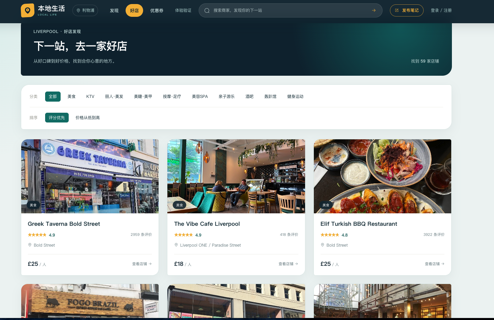
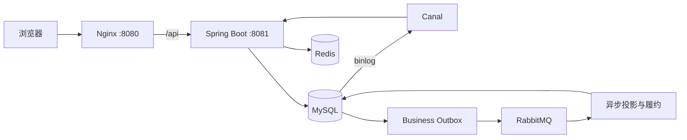

# 本地生活 · Liverpool

面向利物浦华人用户的本地生活平台。项目提供餐饮、娱乐、美容、亲子、运动等店铺发现能力，并保留优惠券、探店笔记、关注、签到和订单等演示功能。

本项目由原有本地生活课程项目迁移而来，业务场景、店铺数据、页面品牌和货币展示已经切换到英国利物浦。

## 当前场景

| 项目 | 当前约定 |
| --- | --- |
| 服务城市 | 英国利物浦 Liverpool |
| 主要用户 | 在英国生活的华人用户 |
| 页面语言 | 中文 |
| 登录方式 | 中国大陆手机号 `+86` 与验证码 |
| 货币 | 英镑 `£` |
| 店铺数据 | 59 家利物浦店铺 |
| 店铺分类 | 沿用原有 10 类分类 |
| 地理坐标 | 利物浦演示坐标，支持西经负值 |
| 图片策略 | 优先使用远程链接，加载失败显示“暂无图片” |
| 探店笔记 | 初始为空，由用户后续发布 |
| 优惠券 | 保留 1 张演示券 |
| 业务消息队列 | RabbitMQ |

### 店铺分类覆盖

- 美食：41 家。
- KTV、丽人·美发、健身运动、按摩·足疗、美容 SPA、亲子游乐、酒吧、轰趴馆、美睫·美甲：每类 2 家。
- `type_id=4` 对应“健身运动”。
- `type_id=10` 对应“美睫·美甲”。

未知的均价、销量、评论数、评分、营业时间和图片字段保留为 `NULL`，不会用 `0` 冒充真实数据。相同地址或相同演示坐标属于允许的数据情况。

## 页面预览

### 登录页面


### 店铺内容示例



## 主要功能

| 模块 | 功能 |
| --- | --- |
| 城市首页 | 利物浦城市视觉、分类入口、精选店铺、优惠券和探店内容 |
| 店铺目录 | 分类、关键词、均价、评分和分页排序 |
| 店铺详情 | 图片、地址、营业时间、评分、优惠券和探店记录 |
| 地理位置 | Redis GEO 附近店铺查询 |
| 用户系统 | 手机验证码登录、令牌刷新、资料、注销和签到 |
| 探店社区 | 发布笔记、图片上传、点赞、关注和关注动态 |
| 优惠券 | 普通券、演示订单、订单快照和本人订单 |
| 秒杀演示 | Redis Lua 预占、异步履约、幂等和补偿 |
| 缓存 | 请求缓存、Caffeine、Redis 与 MySQL 多层查询 |
| 数据同步 | Canal 监听店铺和优惠券变更并清理缓存 |
| 可靠消息 | RabbitMQ 承载 Outbox 后的异步业务任务 |

## 系统架构



RabbitMQ 是当前业务消息队列。它负责可靠业务消息、Feed 投影、缓存失效、订单履约和延迟关单等异步任务。

仓库中仍保留 RocketMQ 兼容实现和开发服务，方便后续对比或回归；默认应用 provider 已设置为 `rabbitmq`，当前场景不使用 RocketMQ 处理业务消息。

## 技术栈

| 分类 | 组件 |
| --- | --- |
| 后端 | Java 8、Spring Boot 2.3.12、MyBatis-Plus 3.4.3 |
| 数据库 | MySQL 8、Flyway |
| 缓存与协调 | Redis 7、Redisson、Caffeine |
| 业务消息 | RabbitMQ 4.4、事务 Outbox、Inbox 去重 |
| 数据同步 | Canal 1.1.8 |
| 前端 | Vue 2、原生 HTML/CSS/JavaScript、Nginx |
| 监控 | Spring Boot Actuator、Micrometer、Prometheus、Alertmanager |
| 运行环境 | Docker Compose |

## 快速启动

### 环境要求

- Docker Desktop 或 Docker Engine。
- Docker Compose v2。
- 首次运行时能够下载项目所需镜像和 Maven 依赖。

在项目根目录执行：

```bash
docker compose -p hm-dianping -f dev/docker-compose.yml up -d
docker compose -p hm-dianping -f dev/docker-compose.yml ps -a
docker compose -p hm-dianping -f dev/docker-compose.yml logs -f java
```

看到 Spring Boot 启动完成后，可按 `Ctrl+C` 退出日志跟踪。退出日志不会停止容器。

### 默认入口

| 服务 | 地址 |
| --- | --- |
| 本地生活首页 | [http://127.0.0.1:8080/](http://127.0.0.1:8080/) |
| 店铺目录 | [http://127.0.0.1:8080/shop-list.html](http://127.0.0.1:8080/shop-list.html) |
| 优惠券页面 | [http://127.0.0.1:8080/vouchers.html](http://127.0.0.1:8080/vouchers.html) |
| 体验验证页 | [http://127.0.0.1:8080/experience.html](http://127.0.0.1:8080/experience.html) |
| Java API | `http://127.0.0.1:8081` |
| 健康检查 | [http://127.0.0.1:8081/actuator/health](http://127.0.0.1:8081/actuator/health) |
| RabbitMQ 管理页面 | [http://127.0.0.1:15672/](http://127.0.0.1:15672/) |

本地 RabbitMQ 默认凭证：

```text
用户名：hmdp
密码：hmdp_local_only
VHost：/hmdp
```

这些凭证只用于本地开发，部署到共享环境时必须通过环境变量覆盖。

## RabbitMQ 配置

完整开发环境默认启用 RabbitMQ：

```text
HMDP_MQ_ENABLED=true
HMDP_MQ_PROVIDER=rabbitmq
HMDP_RABBITMQ_HOST=rabbitmq
HMDP_RABBITMQ_PORT=5672
HMDP_RABBITMQ_USER=hmdp
HMDP_RABBITMQ_VHOST=/hmdp
```

业务交换机和队列由应用自动声明，核心配置位于：

- `src/main/java/com/hmdp/messaging/RabbitMqTopology.java`
- `src/main/java/com/hmdp/messaging/RabbitMqTransport.java`
- `src/main/resources/application.yaml`

检查 RabbitMQ 容器和 Java 连接状态：

```bash
docker compose -p hm-dianping -f dev/docker-compose.yml ps rabbitmq java
docker compose -p hm-dianping -f dev/docker-compose.yml logs --tail=200 rabbitmq java
```

修改 `.env` 或 Compose 环境变量后，应重新创建 Java 容器；仅执行 `restart` 不会重新读取环境变量：

```bash
docker compose -p hm-dianping -f dev/docker-compose.yml up -d --force-recreate java
```

## 数据来源与迁移

利物浦数据位于 [`uk_data`](uk_data)：

| 文件 | 用途 |
| --- | --- |
| `liverpool_shops_with_coords_images.json` | 生成数据库迁移 SQL 的主数据源 |
| `liverpool_shops_with_coords_images.csv` | 通用数据交换和人工检查 |
| `Liverpool_59家_图片与坐标补全.xlsx` | 图片、坐标和分类核验 |
| `README.md` | 数据约定和迁移操作说明 |

修改 JSON 后重新生成可重复迁移：

```bash
node scripts/migration/generate_liverpool_shop_sql.mjs
```

相关迁移文件：

- `V10__adapt_shop_for_uk_catalog.sql`：允许西经负数、空图片和空统计字段。
- `R__liverpool_shop_catalog.sql`：按店铺 ID 幂等导入 59 家店铺。
- `cutover_liverpool_demo.sql`：移除原课程演示店铺和笔记，并迁移演示券。
- `verify_liverpool_shop_data.sql`：校验数量、分类、坐标和遗留数据。
- `rebuild_liverpool_shop_geo.sh`：清理店铺缓存并重建 Redis GEO 索引。

已有环境的完整迁移步骤见 [`uk_data/README.md`](uk_data/README.md)。执行切换脚本前必须备份数据库。

## 最小验收

### 接口验收

```bash
curl -fsS 'http://127.0.0.1:8080/api/shop-type/list'
curl -fsS 'http://127.0.0.1:8080/api/shop/catalog?page=1&size=3&sort=score'
curl -fsS 'http://127.0.0.1:8080/api/shop/900046'
curl -fsS 'http://127.0.0.1:8080/api/shop/900058'
curl -fsS 'http://127.0.0.1:8080/api/voucher/list/900001'
curl -fsS 'http://127.0.0.1:8080/api/blog/hot?current=1'
```

预期结果：

- 店铺分类共 10 类。
- 店铺目录总数为 59。
- `900046` 属于美睫·美甲，`typeId=10`。
- `900058` 属于健身运动，`typeId=4`。
- 900001 店铺下存在 `£50代金券`。
- 初始热门探店笔记为空。

### 页面验收

- 页面品牌为“本地生活”。
- 首页城市为“利物浦”，主标题为“探索这座城”。
- 店铺金额使用英镑 `£`。
- 缺少图片或远程图片失败时显示“暂无图片”。
- 10 个分类均能打开对应店铺列表。
- 页面在桌面和窄屏下均能正常浏览。

## 登录与演示数据

页面继续使用中国大陆手机号登录，因为平台面向英国华人用户。验证码目前不接入真实短信服务，会输出到 Java 调试日志：

```bash
docker compose -p hm-dianping -f dev/docker-compose.yml logs --since=2m java
```

请勿在共享环境公开完整日志。正式上线前应接入短信服务或设计明确的演示账号方案。

优惠券、秒杀和模拟付款用于功能展示，不代表真实支付或核销。模拟付款默认关闭。

## 项目结构

```text
hm-dianping/
├── src/main/java/com/hmdp/
│   ├── controller/       HTTP 接口
│   ├── service/          业务逻辑与事务
│   ├── mapper/           MyBatis 数据访问
│   ├── entity/、dto/     实体与传输对象
│   ├── cache/            多层缓存与 Canal 消费
│   ├── messaging/        RabbitMQ、Outbox 与消息幂等
│   ├── analytics/        行为事件与热度聚合
│   └── reliability/      限流、审计与故障恢复
├── src/main/resources/
│   ├── db/hmdp.sql       基础数据库初始化
│   ├── db/migration/     Flyway 增量与利物浦数据迁移
│   ├── mapper/           MyBatis Mapper XML
│   └── *.lua             Redis 原子脚本
├── frontend/             本地生活前端页面
├── uk_data/              利物浦店铺主数据
├── scripts/migration/    数据切换、生成、校验和缓存脚本
├── dev/                  本地 Compose、RabbitMQ 与监控配置
├── deploy/               轻量部署配置
├── docs/                 验证记录
└── wiki/                 原有技术专题说明
```

## 构建与测试

### Java

```bash
sh dev/java-style.sh check
mvn -DskipTests package
```

运行完整 Java 测试需要独立测试环境，避免连接业务数据库：

```bash
docker volume create hm-dianping_maven-cache
docker compose -p hmdp-optimization-test -f dev/docker-compose.test.yml run --rm test
docker compose -p hmdp-optimization-test -f dev/docker-compose.test.yml down -v
```

### 前端

```bash
npm --prefix frontend run check
npm --prefix frontend test
```

当前前端自动化测试覆盖长整型 ID、登录返回地址、图片占位、优惠券金额格式、API 超时和体验页结果判断。

## 常用配置

| 环境变量 | 开发默认值 | 用途 |
| --- | --- | --- |
| `HMDP_WEB_PORT` | `8080` | 网页端口 |
| `HMDP_API_PORT` | `8081` | Java API 端口 |
| `HMDP_MYSQL_PASSWORD` | `hmdp_local_only` | MySQL root 密码 |
| `HMDP_MQ_ENABLED` | `true` | 启用可靠业务消息 |
| `HMDP_MQ_PROVIDER` | `rabbitmq` | 当前业务 MQ provider |
| `HMDP_RABBITMQ_USER` | `hmdp` | RabbitMQ 用户名 |
| `HMDP_RABBITMQ_PASSWORD` | `hmdp_local_only` | RabbitMQ 密码 |
| `HMDP_EXPERIENCE_ENABLED` | `true` | 启用体验观察接口 |
| `HMDP_ADMIN_IDS` | 空 | 管理员用户 ID 白名单 |
| `HMDP_PAYMENT_MOCK_ENABLED` | `false` | 本地模拟付款 |

配置可以写入项目根目录 `.env`。不要提交包含真实密码、Token 或生产地址的 `.env` 文件。

## 停止与更新

保留数据停止：

```bash
docker compose -p hm-dianping -f dev/docker-compose.yml down
```

不要在需要保留数据的环境执行 `down -v`。更新代码和迁移前，应备份 MySQL、Redis、上传图片和环境配置。

## 当前限制

- 店铺图片主要来自第三方链接，可能随源站策略变化而失效。
- 坐标只用于功能演示，不保证导航级精度。
- 验证码尚未接入真实短信。
- 优惠券、秒杀和付款为演示业务，不具备完整核销、退款和真实支付闭环。
- 初始探店笔记为空，需要用户登录后自行发布。
- `deploy/` 中的轻量部署配置默认关闭 RabbitMQ 和 Canal；它用于低资源演示，不代表完整生产架构。完整业务环境应启用 RabbitMQ 并重新评估资源、备份、HTTPS 和监控策略。
