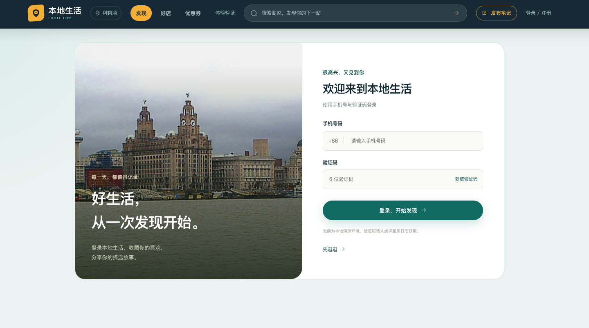
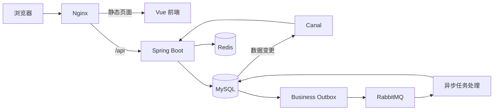

# 本地生活 · Liverpool

面向利物浦华人用户的本地生活平台，围绕城市探索、店铺发现和社区分享提供一站式体验。用户可以浏览不同类型的本地商家，按分类或关键词寻找目的地，查看店铺信息与优惠内容，并通过探店笔记记录自己的城市生活。

## 产品场景

| 项目 | 说明 |
| --- | --- |
| 服务城市 | 英国利物浦 Liverpool |
| 主要用户 | 在英国生活、学习或旅行的华人用户 |
| 页面语言 | 中文 |
| 登录方式 | 中国大陆手机号 `+86` 与验证码 |
| 货币显示 | 英镑 `£` |
| 内容形式 | 店铺目录、店铺详情、优惠券、探店笔记和个人中心 |
| 图片体验 | 店铺图片、城市视觉以及缺图状态的统一展示 |

## 店铺分类

平台按照日常生活场景组织店铺内容。各分类都支持查看店铺名称、所在区域、详细地址、图片和位置；当店铺提供相应资料时，还会展示人均消费、用户评分、评价数量、营业时间、优惠券和探店笔记。

| 分类 | 功能说明 |
| --- | --- |
| 美食 | 汇集餐厅、咖啡馆和特色餐饮。用户可以结合位置、评分、人均消费与营业时间选择用餐地点，也可以进入详情页查看图片、优惠和其他用户的探店记录。 |
| KTV | 用于发现唱歌和聚会场所。页面集中呈现所在区域、地址、营业安排和消费信息，方便用户规划朋友聚会或夜间娱乐。 |
| 丽人·美发 | 收录美发及个人造型相关门店。用户可以通过门店图片、位置、评价和笔记了解环境与体验，再决定是否前往。 |
| 健身运动 | 覆盖健身、攀岩等运动场所。用户可以查看场馆位置、营业时间、价格信息和评价，为日常锻炼或周末活动做准备。 |
| 按摩·足疗 | 面向休闲放松场景，提供门店区域、地址、营业时间、消费信息和用户反馈，帮助用户快速比较附近选择。 |
| 美容 SPA | 展示美容、护理与 SPA 场所。店铺详情可结合图片、地理位置、营业安排和探店内容呈现整体环境。 |
| 亲子游乐 | 聚合适合家庭共同参与的休闲娱乐场所。用户可以通过位置、场地图片和评价了解目的地，并安排亲子出行。 |
| 酒吧 | 用于发现利物浦的夜间社交与休闲场所。用户可以查看地址、营业时间、评分和店铺图片，规划晚间活动。 |
| 轰趴馆 | 收录适合多人聚会、互动娱乐和团体活动的场所，支持通过区域、环境图片和评价筛选聚会地点。 |
| 美睫·美甲 | 提供美甲、美睫等门店信息。用户可以查看门店位置、环境、营业信息和社区笔记，了解实际到店体验。 |

## 页面预览

### 登录页面



### 店铺内容示例


## 主要功能

| 模块 | 功能 |
| --- | --- |
| 城市首页 | 展示利物浦城市视觉、分类入口、精选店铺、优惠内容和社区动态 |
| 店铺目录 | 支持分类浏览、关键词搜索、分页加载以及按评分或价格排序 |
| 店铺详情 | 集中展示图片、地址、营业时间、评分、消费信息、优惠券和探店记录 |
| 附近发现 | 根据地理位置查找同一分类下的附近店铺，并展示距离信息 |
| 用户系统 | 支持手机号验证码登录、个人资料、登录状态管理、注销和签到 |
| 探店社区 | 支持发布图文笔记、上传图片、点赞、关注以及查看关注动态 |
| 优惠券与订单 | 支持查看店铺优惠、领取优惠券以及管理个人订单 |
| 活动参与 | 支持限时优惠活动、资格校验、库存处理和结果查询 |

## 系统架构



浏览器首先访问 Nginx：页面和静态资源直接返回，`/api` 请求则转发给 Spring Boot。业务服务通过 MySQL 保存用户、店铺、优惠券、订单和社区内容，通过 Redis 提供登录状态、热点缓存、位置检索和活动资格处理。

Canal 关注数据库中的关键内容变化，并通知应用及时更新相关缓存。需要异步完成的任务会先与业务数据一起记录到 Outbox，再由 RabbitMQ 分发给任务处理器；消费者通过幂等控制安全地完成社区投影、缓存更新、订单处理和定时任务。这样的流程既保持了用户请求的响应速度，也让后台任务具备可追踪和可恢复的处理路径。

## 技术栈

| 分类 | 组件 |
| --- | --- |
| 后端 | Java 8、Spring Boot 2.3.12、MyBatis-Plus 3.4.3 |
| 数据库 | MySQL 8、Flyway |
| 缓存与协调 | Redis 7、Redisson、Caffeine |
| 业务消息 | RabbitMQ、事务 Outbox、Inbox 去重 |
| 数据同步 | Canal |
| 前端 | Vue 2、HTML、CSS、JavaScript、Nginx |
| 监控 | Spring Boot Actuator、Micrometer、Prometheus、Alertmanager |
| 运行环境 | Docker Compose |

## 快速启动

### 环境要求

- Docker Desktop 或 Docker Engine。
- Docker Compose v2。
- 首次运行时能够下载项目镜像和 Maven 依赖。

在项目根目录执行：

```bash
docker compose -f dev/docker-compose.yml up -d
docker compose -f dev/docker-compose.yml ps -a
docker compose -f dev/docker-compose.yml logs -f java
```

看到 Spring Boot 启动完成后，可按 `Ctrl+C` 退出日志跟踪。退出日志不会停止服务。

### 默认入口

| 服务 | 地址 |
| --- | --- |
| 本地生活首页 | [http://127.0.0.1:8080/](http://127.0.0.1:8080/) |
| 店铺目录 | [http://127.0.0.1:8080/shop-list.html](http://127.0.0.1:8080/shop-list.html) |
| 优惠券页面 | [http://127.0.0.1:8080/vouchers.html](http://127.0.0.1:8080/vouchers.html) |
| 体验验证页 | [http://127.0.0.1:8080/experience.html](http://127.0.0.1:8080/experience.html) |
| Java API | `http://127.0.0.1:8081` |
| 健康检查 | [http://127.0.0.1:8081/actuator/health](http://127.0.0.1:8081/actuator/health) |

## 接口与页面验收

检查分类与店铺目录接口：

```bash
curl -fsS 'http://127.0.0.1:8080/api/shop-type/list'
curl -fsS 'http://127.0.0.1:8080/api/shop/catalog?page=1&size=3&sort=score'
```

接口应返回成功状态以及分类或店铺内容。随后在浏览器中确认：

- 页面品牌显示为“本地生活”。
- 首页城市为“利物浦”，主标题为“探索这座城”。
- 店铺价格使用英镑 `£`。
- 图片、地址、营业信息和评分布局清晰。
- 缺少图片或图片加载失败时显示“暂无图片”。
- 各分类能够打开对应的店铺列表。
- 桌面和窄屏页面均可正常浏览。

## 项目结构

```text
project/
├── src/main/java/
│   ├── controller/       HTTP 接口
│   ├── service/          业务逻辑与事务
│   ├── mapper/           数据访问接口
│   ├── entity/、dto/     实体与传输对象
│   ├── cache/            缓存与数据变更处理
│   ├── messaging/        RabbitMQ、Outbox 与消息幂等
│   ├── analytics/        行为事件与热度聚合
│   └── reliability/      限流、审计与故障恢复
├── src/main/resources/   应用配置、数据库脚本、Mapper XML 与 Redis 脚本
├── frontend/             本地生活前端页面
├── picture/              README 页面预览图片
├── dev/                  本地开发与容器编排配置
├── deploy/               部署配置
├── docs/                 验证记录
└── wiki/                 技术专题说明
```

## 构建与测试

### Java

```bash
sh dev/java-style.sh check
mvn -DskipTests package
```

### 前端

```bash
npm --prefix frontend run check
npm --prefix frontend test
```

前端自动化测试覆盖长整型 ID、登录返回地址、图片占位、优惠券金额格式、API 超时和体验页结果判断。

## 停止服务

```bash
docker compose -f dev/docker-compose.yml down
```

该命令会停止并移除容器与网络，默认保留持久化数据卷。
